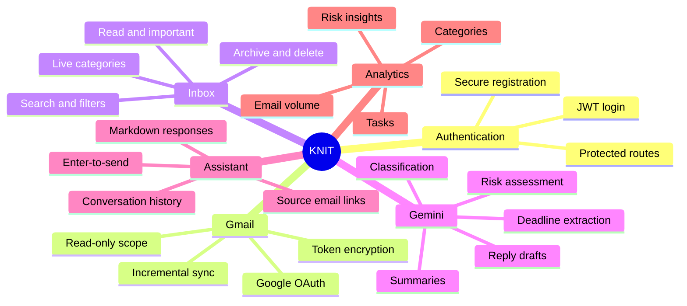
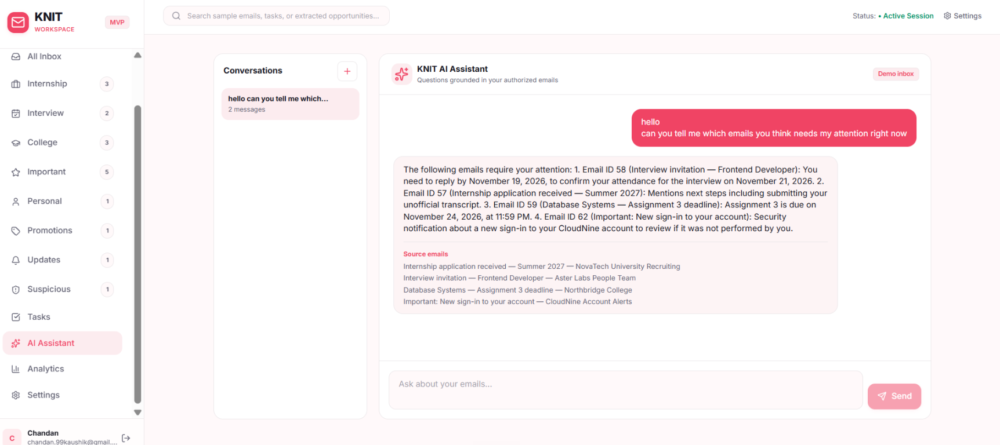
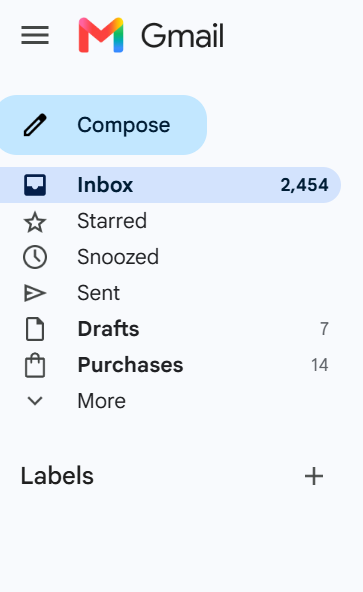
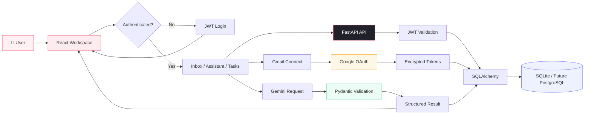
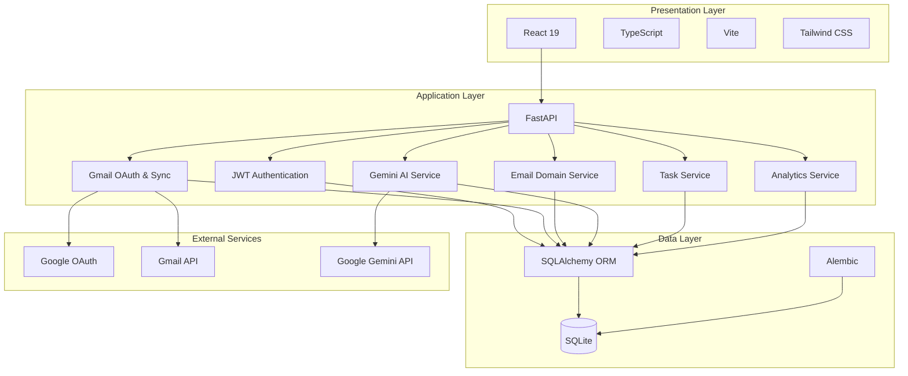
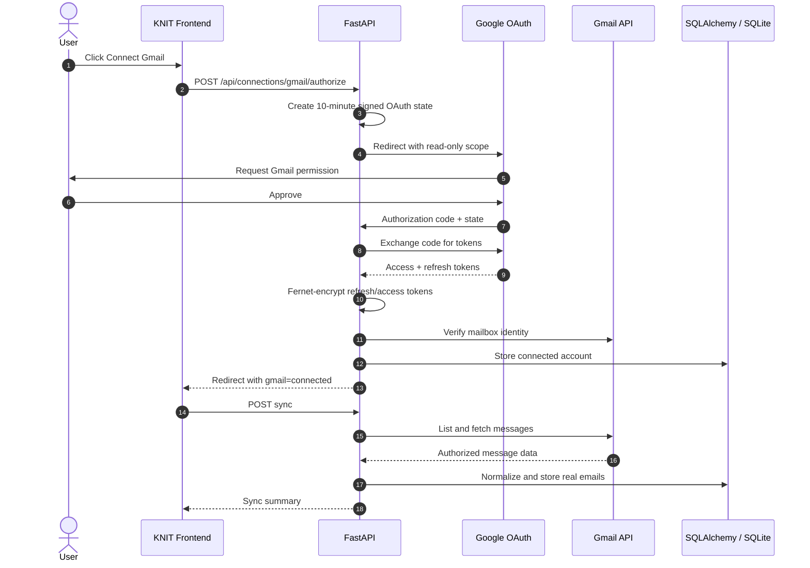
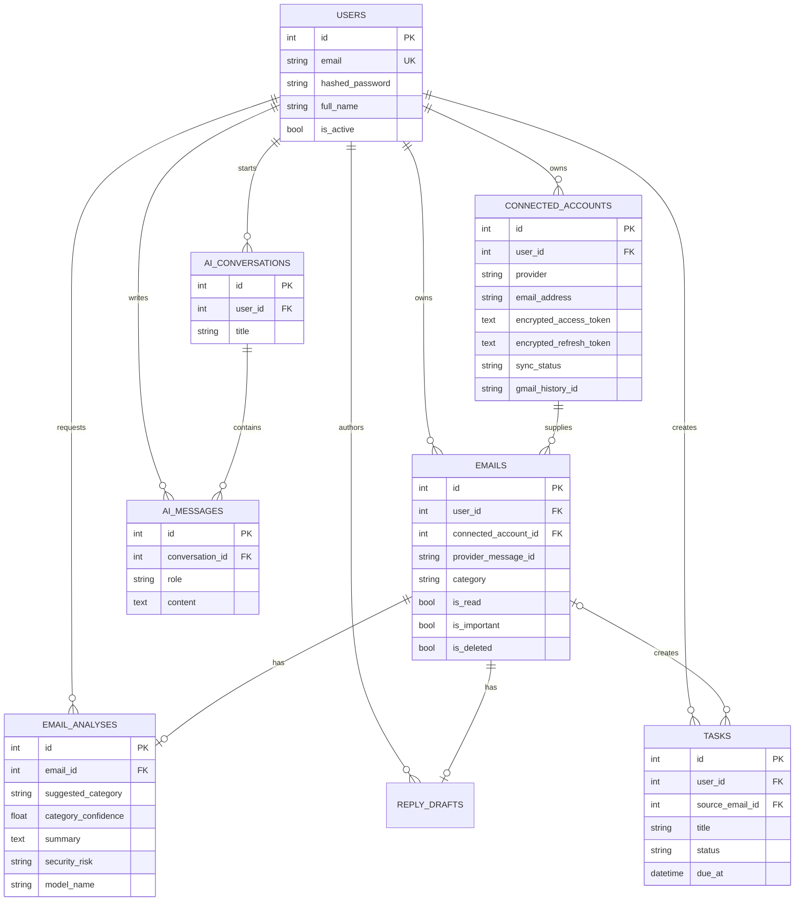
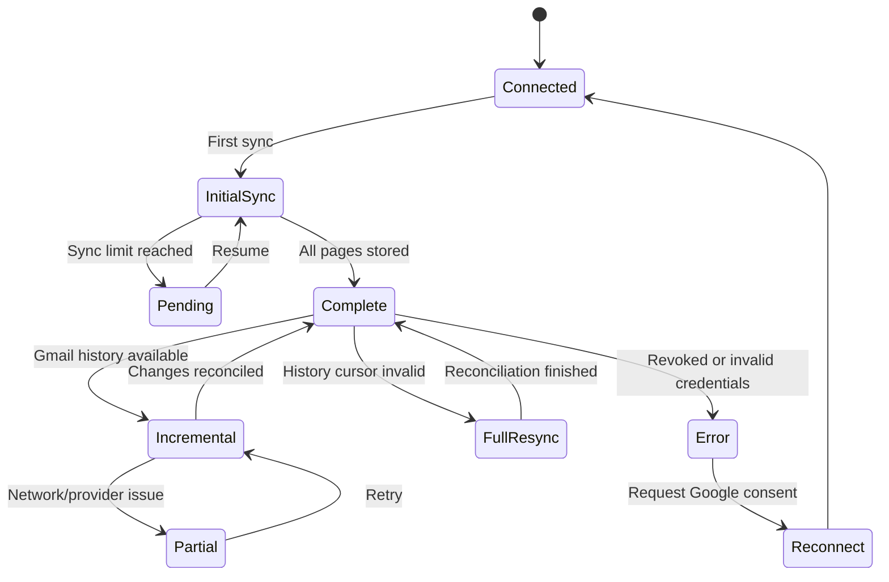
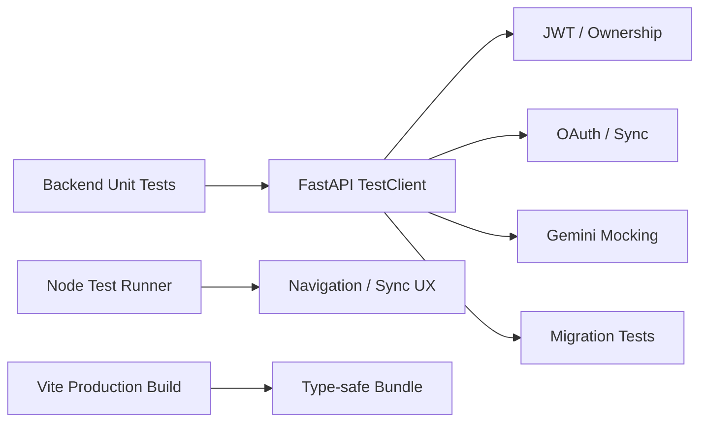

<div align="center">


# KNIT

### Connect. Understand. Act.

**An AI-powered Gmail intelligence workspace that turns an overwhelming inbox into structured decisions.**

[](LICENSE)
[](frontend/)
[](backend/)
[](https://ai.google.dev/)
[](https://developers.google.com/gmail/api)

<br/>

[Features](#-feature-map) • [Screenshots](#-interactive-project-tour) • [Architecture](#-system-architecture) • [Database](#-database-model) • [Setup](#-quick-start) • [Testing](#-quality-assurance) • [Report](#-project-report-view)

</div>

---

##  Project in One Minute

**KNIT** is a full-stack email productivity platform built as a final-year B.Tech project. It connects a Gmail mailbox through Google OAuth, imports emails securely, organizes them by category and importance, analyzes them with Gemini, generates structured summaries and replies, and provides a conversational AI assistant grounded in the user's authorized emails.

> The project prioritizes **user privacy, controlled AI behavior, database integrity, and real Gmail synchronization**.

<table>
  <tr>
    <td width="25%" align="center"><b>🔐</b><br/><b>Secure Gmail</b><br/>Read-only OAuth</td>
    <td width="25%" align="center"><b>🧠</b><br/><b>Gemini Intelligence</b><br/>Structured AI output</td>
    <td width="25%" align="center"><b>📥</b><br/><b>Smart Inbox</b><br/>Live real mail</td>
    <td width="25%" align="center"><b>💬</b><br/><b>AI Chat</b><br/>Email-grounded answers</td>
  </tr>
</table>

---

## 🗺️ Feature Map



<details open>
<summary><b>Explore major capabilities</b></summary>

| Area | Implemented capabilities |
|---|---|
| **Identity** | Registration, login, JWT authentication, protected API routes |
| **Gmail** | OAuth consent, encrypted access/refresh tokens, initial sync, incremental history sync |
| **Inbox** | Real Gmail data, live category and important counts, search, filters, read state, delete/restore |
| **AI analysis** | Category, confidence, summary, required action, extracted entities, security assessment |
| **AI Assistant** | Multi-conversation chat, owned-email retrieval, Markdown formatting, source-email references |
| **Tasks** | Create, update, complete, priorities, statuses and deadlines |
| **Analytics** | Inbox activity, category distribution, task deadlines and AI insights |
| **UI** | Responsive React workspace, collapsible navigation, animated chat, accessible controls |

</details>

---

## 🖼️ Interactive Project Tour

<details open>
<summary><b>01 — AI Assistant experience</b></summary>

<div align="center">
  
</div>

The assistant presents generated answers as readable Markdown with headings, lists, bold emphasis, tables and links to source emails. It uses only the user's authorized inbox records.

</details>

<details>
<summary><b>02 — Navigation and dropdown menu</b></summary>

<div align="center">
  
</div>

The Gmail-inspired three-line menu opens a full navigation drawer with Inbox, Important, AI Chat, Tasks, Analytics, Settings and email folders.

</details>

<details>
<summary><b>03 — Real inbox workspace</b></summary>

<div align="center">
  
</div>

The inbox reflects the real connected mailbox. Demo seeding is disabled, and counts are generated directly from stored Gmail records.

</details>

---

## 🧭 Interactive Request Flow

Click nodes in a compatible Mermaid renderer to follow the application journey:



---

## 🏗️ System Architecture



<details>
<summary><b>Component responsibility matrix</b></summary>

| Component | Responsibility |
|---|---|
| React / Vite | Responsive UI, routing, API calls and interactive state |
| FastAPI | Authentication, authorization, service routing and validation |
| Pydantic | Request/response and AI output schemas |
| SQLAlchemy | ORM models and database operations |
| Alembic | Versioned schema migrations |
| Gmail Provider | Message listing, normalization and incremental synchronization |
| Gemini Service | Controlled structured AI prompts and provider error handling |
| SQLite | Local persistent relational storage |

</details>

---

## 🛡️ Gmail OAuth Journey



**Security properties**

- Only `gmail.readonly` is permitted.
- OAuth state is single-use and expires after 10 minutes.
- Callback parameters are redacted from access logs.
- Tokens are encrypted at rest.
- Provider details are sanitized before reaching the frontend.
- Gmail credentials remain backend-only.

---

## 🗄️ Database Model



---

## 🔄 Gmail Synchronization State Machine



---

## 🧰 Technology Stack

| Layer | Technology |
|---|---|
| Frontend | React 19, TypeScript, Vite |
| Styling | Tailwind CSS, Lucide icons |
| Chat Rendering | React Markdown, remark-gfm |
| Charts | Recharts |
| Animations | Framer Motion / CSS transitions |
| Backend | Python, FastAPI |
| Validation | Pydantic v2 |
| ORM | SQLAlchemy |
| Migrations | Alembic |
| Authentication | JWT + bcrypt |
| Database | SQLite, migration-ready for PostgreSQL |
| AI | Google Gemini |
| Gmail | Google OAuth 2.0 + Gmail API |
| Test | pytest, Node test runner |

---

## 🚀 Quick Start

### Prerequisites

- Node.js 20+
- Python 3.11+
- npm
- A Google Cloud OAuth Web Client
- A Gemini API key

### 1. Clone

```bash
git clone https://github.com/vaishali0504/knit.git
cd knit
```

### 2. Backend

```bash
cd backend
python -m venv .venv
.venv\Scripts\activate
pip install -r requirements.txt
alembic upgrade head
copy .env.example .env
python -m uvicorn app.main:app --reload --host 127.0.0.1 --port 8000
```

Set private values in `backend/.env`:

```env
GEMINI_API_KEY=your_gemini_key
GMAIL_INTEGRATION_ENABLED=True
GOOGLE_OAUTH_CLIENT_ID=your_client_id
GOOGLE_OAUTH_CLIENT_SECRET=your_client_secret
GMAIL_TOKEN_ENCRYPTION_KEY=your_fernet_key
GOOGLE_OAUTH_REDIRECT_URI=http://127.0.0.1:8000/api/connections/gmail/callback
FRONTEND_URL=http://127.0.0.1:5173
```

Generate a Fernet key:

```bash
python -c "from cryptography.fernet import Fernet; print(Fernet.generate_key().decode())"
```

### 3. Frontend

```bash
cd ../frontend
npm install
npm run dev
```

Open [http://127.0.0.1:5173](http://127.0.0.1:5173).

### 4. Connect Gmail

1. Sign in to KNIT.
2. Open **Settings**.
3. Add a test Gmail account in Google Cloud.
4. Configure the authorized origin and callback URI.
5. Click **Connect Gmail**.
6. Approve read-only access.
7. Click **Sync now**.
8. Open the inbox and confirm real message counts.

---

## 🧪 Quality Assurance



```bash
# Backend
cd backend
pytest

# Frontend tests
cd frontend
npm test
npm run build
npm run lint
```

<details>
<summary><b>Coverage groups</b></summary>

- Authentication and user isolation
- Protected route authorization
- Gmail OAuth state replay and mismatch protection
- Token encryption and decryption
- Sync pagination and incremental history
- User-scoped email operations
- Gemini provider success/failure mapping
- Frontend sync presentation and duplicate-action protection
- Migration upgrade/downgrade behavior

</details>

---

## 🔒 Privacy and Safety

- Gmail refresh/access tokens are stored encrypted.
- Email content is processed only for the signed-in user's owned records.
- Gemini prompts treat email content as untrusted data.
- AI responses are validated before storage.
- The assistant cannot execute actions or access arbitrary database records.
- Secrets are excluded through `.gitignore`.
- The repository does not require an API key to be committed.

---

## 📋 Project Report View

<details>
<summary><b>Abstract</b></summary>

KNIT is a full-stack AI-assisted email management system that integrates Gmail with a secure FastAPI backend and React workspace. It retrieves authorized email data, stores normalized records, performs Gemini-powered analysis and conversational queries, and presents reliable summaries and task insights. The system demonstrates authentication, OAuth 2.0, encryption, REST APIs, database migration, AI integration and responsive human-computer interaction.

</details>

<details>
<summary><b>Problem statement</b></summary>

Modern inboxes contain important information mixed with notifications, promotions and repetitive messages. KNIT reduces cognitive load by organizing mail, identifying urgency, extracting deadlines and enabling grounded natural-language queries.

</details>

<details>
<summary><b>Objectives</b></summary>

1. Securely connect a Gmail mailbox.
2. Store and synchronize real email data.
3. Classify and summarize communications.
4. Extract deadlines and required actions.
5. Provide a grounded AI assistant.
6. Display accurate live analytics.
7. Preserve privacy and user ownership.

</details>

<details>
<summary><b>Future scope</b></summary>

- PostgreSQL deployment
- Draft and send permissions
- Push notifications and Pub/Sub
- Calendar integration
- Semantic/vector search
- Multi-account Gmail support
- Mobile application
- Fine-grained labels and automation rules
- Role-based team workspace

</details>

For the complete engineering documentation, see:

- [System Architecture](docs/ARCHITECTURE.md)
- [Product Requirements](docs/PRD.md)
- [Design System](docs/DESIGN.md)
- [Implementation Rules](docs/RULES.md)
- [Engineering Tasks](docs/TASKS.md)

---

<div align="center">

**KNIT — Connect. Understand. Act.**

Built for meaningful email productivity.

</div>
