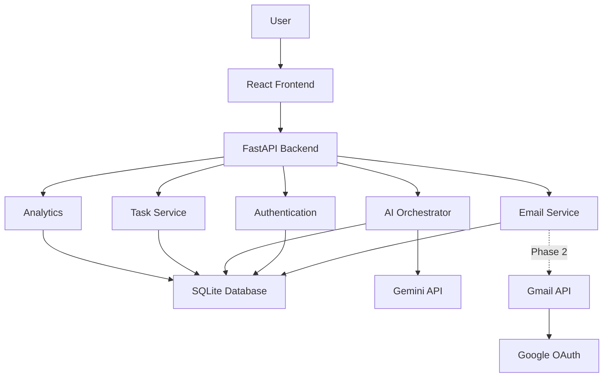
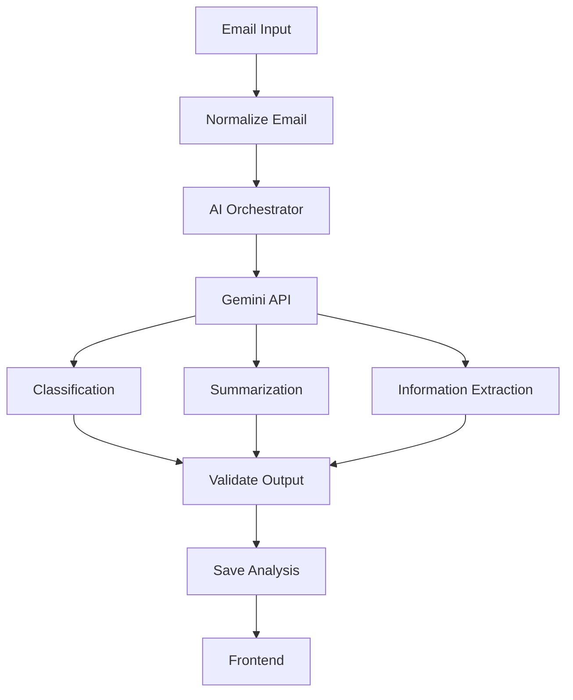
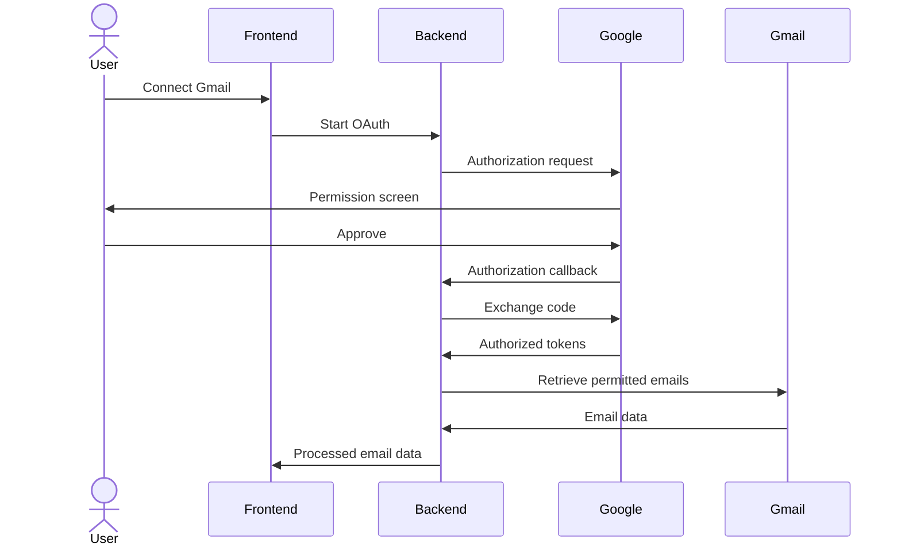
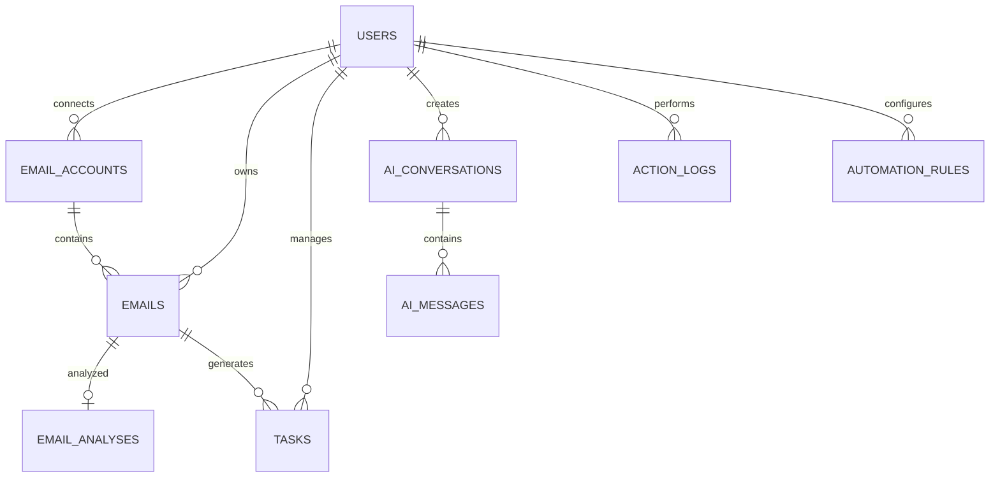

# KNIT — System Architecture

**Product:** KNIT  
**Version:** 1.0  
**Architecture Style:** Modular Monolith

## 1. Architecture Overview

KNIT uses a modular monolithic architecture.

The frontend, backend, database, AI services and external integrations are logically separated but managed within one application.

The initial implementation should prioritize simplicity, maintainability and future scalability.

## 2. Technology Stack

| Layer | Technology |
|---|---|
| Frontend | React + Vite |
| Language | TypeScript |
| Styling | Tailwind CSS |
| UI Icons | Lucide React |
| Animations | Framer Motion |
| Charts | Recharts |
| Backend | Python + FastAPI |
| Validation | Pydantic |
| ORM | SQLAlchemy |
| Migrations | Alembic |
| Initial Database | SQLite |
| Future Database | PostgreSQL |
| AI | Google Gemini API |
| Email Integration | Gmail API |
| Authentication | Email/password JWT for KNIT; Google OAuth 2.0 for Gmail authorization only |

Use Gemini API through the backend only.

Do not introduce additional frameworks or services without a clear requirement.

## 3. High-Level Architecture



## 4. Frontend Architecture

The frontend manages user interaction and displays application data.

### Main Pages

- Landing Page
- Login / Signup
- Dashboard
- Smart Inbox
- Email Details
- AI Assistant
- Tasks
- Automation
- Analytics
- Settings

### Frontend Responsibilities

- Render responsive UI.
- Display email categories and summaries.
- Manage search and filters.
- Display tasks and deadlines.
- Communicate with backend APIs.
- Show loading, error and success states.
- Display action confirmation dialogs.

Frontend must never contain secret API keys or Gmail OAuth tokens.

## 5. Backend Architecture

FastAPI acts as the central application layer.

### Main Modules

| Module | Responsibility |
|---|---|
| Auth | User authentication and authorization |
| Email | Email retrieval, storage and management |
| AI | Classification, summaries and extraction |
| Assistant | Natural-language queries and tool coordination |
| Tasks | Task and deadline management |
| Actions | Validate and execute permitted actions |
| Analytics | Generate dashboard statistics |
| Gmail | Official Gmail API integration |

Keep business logic inside backend services rather than placing it directly inside API route handlers.

## 6. AI Architecture

The AI Orchestrator manages communication with Gemini.

### AI Processing Flow



### AI Capabilities

1. Email classification.
2. Email summarization.
3. Task and deadline extraction.
4. Internship and interview information extraction.
5. Context-aware reply generation.
6. Natural-language email queries.

### AI Output Requirements

- Use structured JSON responses.
- Validate outputs using Pydantic.
- Handle missing and uncertain information.
- Store AI results separately from original email content.
- Do not treat AI predictions as guaranteed facts.

## 7. AI Assistant and Tool Architecture

The assistant should use controlled backend tools.

Approved tools may include:

- search_emails
- get_email_details
- get_tasks
- summarize_email
- extract_deadlines
- create_reply_draft
- mark_email_read
- mark_email_important

The assistant must not receive unrestricted database or Gmail access.

The backend validates every requested tool operation.

## 8. Gmail Integration

Gmail integration is Phase 10 work, after the sample-data MVP. Phase 10.1 prepares configuration only; OAuth flow and synchronization are later approved subphases.

Use official Gmail API and Google OAuth 2.0.

### Integration Flow



### Gmail Requirements

- Use minimum required OAuth scopes.
- Start with only `https://www.googleapis.com/auth/gmail.readonly`.
- Store OAuth tokens securely and encrypted.
- Never expose tokens to the frontend.
- Handle token expiry and revocation.
- Support pagination and synchronization.
- Do not request compose, modify or send permissions during initial read-only integration.
- Keep Gmail OAuth separate from KNIT email/password authentication.

Backend-only settings: `GOOGLE_OAUTH_CLIENT_ID`, `GOOGLE_OAUTH_CLIENT_SECRET`, `GOOGLE_OAUTH_REDIRECT_URI`, `GMAIL_OAUTH_SCOPES`, and `GMAIL_TOKEN_ENCRYPTION_KEY`. `GMAIL_INTEGRATION_ENABLED` defaults to false. When enabled, required values are validated, only the Gmail read-only scope is allowed, and redirect URIs must be absolute HTTP(S), with HTTPS required outside development. Token encryption behavior is Phase 10.2, not part of configuration setup.

Environment managers using `JWT_SECRET_KEY`, `JWT_ACCESS_TOKEN_EXPIRE_MINUTES`, `TOKEN_ENCRYPTION_KEY`, `GOOGLE_CLIENT_ID`, `GOOGLE_CLIENT_SECRET`, `GMAIL_REDIRECT_URI`, or `ALLOWED_ORIGINS` are supported as aliases for the existing settings. `FRONTEND_URL` is an optional frontend origin and is included in CORS; `SQLITE_DB_PATH` is intentionally not read because the SQLite location is controlled by `DATABASE_URL`.

Local callback URI: `http://127.0.0.1:8000/api/connections/gmail/callback`.
Production callback convention: `https://<backend-api-host>/api/connections/gmail/callback`. Register the exact deployed URI with Google; do not use wildcards.

### Google Cloud setup (Phase 10.1)

1. Create or select a Google Cloud project for KNIT.
2. Enable the Gmail API in that project.
3. Configure the OAuth consent screen: app name, support email, developer contact, authorized domains, and test users for development. Complete Google's verification requirements before production use when applicable.
4. Create an OAuth client with application type **Web application**.
5. Add the exact local callback above under authorized redirect URIs. For production, add the exact HTTPS callback for the deployed backend. Configure authorized JavaScript origins only if the chosen authorization flow requires them.
6. Put the client ID and secret only in backend environment configuration. Keep the token-encryption key in backend secret management. Never use `VITE_` variables for OAuth secrets or encryption keys.
7. Request only the Gmail read-only scope. Do not connect an account during Phase 10.1.

### Connected accounts and token storage (Phase 10.2)

- `connected_accounts` stores user ownership, Gmail provider/account identifiers, email address, Fernet-encrypted access/refresh tokens, expiry, granted scopes, history cursor, sync status/timestamps, and sanitized error fields.
- A uniqueness constraint on `(user_id, provider, provider_account_id)` allows the same Gmail identity to be independently connected by different KNIT users.
- `emails` has nullable `connected_account_id`, `provider_message_id`, and `provider_thread_id` fields. Unique `(connected_account_id, provider_message_id)` prevents duplicate provider messages while preserving multiple local/sample rows with null provider references. Account deletion sets the optional email reference to null; it does not delete email or task records.
- OAuth token encryption uses the maintained `cryptography` package's Fernet authenticated encryption. Generate a Fernet-compatible key for `GMAIL_TOKEN_ENCRYPTION_KEY` and store it only in backend secret configuration. Missing/invalid keys and invalid ciphertext fail closed with sanitized errors. Key rotation and re-encryption are future operational work.
- The token encryption service is backend-only. No OAuth routes, API responses, frontend token handling, Gmail requests, or synchronization were added in Phase 10.2.

### Gmail connection lifecycle (Phase 10.3)

- `POST /api/connections/gmail/authorize` requires a KNIT JWT, stores a SHA-256 hash of a cryptographically random state bound to the user with a ten-minute expiry, and returns a Google authorization URL requesting offline access and only the configured read-only scope.
- `GET /api/connections/gmail/callback` consumes valid state once before exchanging the code, obtains the Gmail profile identity, encrypts tokens, and redirects to the first configured frontend origin at the fixed `/app/settings` route. Callback parameters cannot choose a redirect URL.
- `GET /api/connections` lists only the authenticated user's Gmail connection metadata; token and provider account identifiers are omitted.
- `DELETE /api/connections/{id}` checks ownership, attempts Google revocation, then removes local credentials even if revocation is unavailable. It detaches email references first, preserving imported emails and tasks.
- OAuth provider calls are isolated in `gmail_oauth`; tests mock all HTTP calls. This phase does not list messages, sync, fetch content, or access attachments.

### Gmail synchronization (Phases 10.4–10.5)

- `POST /api/connections/{id}/sync` is authenticated and loads the connection by both account ID and KNIT user ID.
- `EmailProvider` is a small protocol for account identity, paged message listing, individual message retrieval, and Gmail history retrieval. `GmailProvider` calls only Gmail read endpoints over HTTPS; `gmail_normalizer` maps provider payloads to KNIT `Email` fields, and `email_sync` owns token refresh, bounded iteration, deduplication, persistence, and status.
- Sync limits are backend settings `GMAIL_SYNC_MAX_MESSAGES` (default 100, max 500) and `GMAIL_SYNC_PAGE_SIZE` (default 25, max 100). Initial and history pagination is capped per run at the ceiling of message limit divided by page size; history changes, including removals, also count against the per-run message budget. Pending page tokens allow a later user-triggered run to continue. Syncs use a database lease timestamp and conditional update to reject concurrent runs, reclaiming a lease after 15 minutes.
- Access tokens are decrypted only in the sync service, refreshed server-side as needed, and stored encrypted including refresh-token rotation. The provider scope must equal `gmail.readonly`.
- Initial imports create provider-linked email records and retain attachment metadata without fetching attachment bodies. Gmail labels are read only to derive unread/important flags. Incremental updates affect only provider-linked records and preserve locally modified read, important, and deleted values; sample emails remain unlinked and untouched.
- The initial list operation snapshots Gmail `historyId` before paging and commits it as the cursor only after all pages/messages are processed. Incremental sync stores the starting cursor and history page token separately, commits each processed page, and advances the durable cursor only after every history page succeeds. Replayed events are idempotent.
- Gmail `messagesDeleted` events and `TRASH` label additions soft-delete the corresponding linked KNIT email; removing `INBOX` alone is treated as archive, not deletion. An HTTP 404 for history invalidates the cursor and sets `full_resync_required`; the next sync performs a bounded full listing and reconciles unseen provider-linked records as removed. No cursor advances on partial processing.
- Migration `9b0c1d2e3f4a` adds durable page/baseline state and provider-seen/user-override flags. A database lease prevents concurrent account syncs. Failures retain the cursor/page for safe replay and expose only sanitized status/counts; retries are user-triggered. The endpoint returns `sync_type`, `added`, `updated`, `removed`, status, and last successful sync time.

### Gmail Settings and sync controls (Phase 10.6)

- The existing Settings page uses `GET /api/connections` for safe account metadata and `POST /api/connections/{id}/sync` for sync actions; no backend API or provider changes are needed for the Settings controls.
- Per-account controls show connection/sync state and last successful sync time, disable repeat sync actions while a request is active, display initial/incremental added/updated/removed counts, and refresh connection metadata when sync finishes.
- Recoverable failures offer retry. Reauthorization failures offer reconnect using the existing authorization flow; expired history is clearly shown as `full_resync_required` with an explicit full-resync action. Disconnect confirmation explains imported KNIT email and task preservation.
- The UI displays only safe server status/message fields; it never handles OAuth tokens, authorization codes, or encryption data. Responsive layouts use the existing KNIT utility classes/design tokens. No provider, scope, cursor, database, or backend behavior changes are part of 10.6.

### Gmail security and release hardening (Phase 10.7)

- OAuth callback query parameters contain short-lived state and authorization codes. `OAuthCallbackQueryRedactionMiddleware` preserves the query for callback processing, then removes it from the ASGI scope before Uvicorn formats the access log. Callback redirects also use `Cache-Control: no-store` and `Referrer-Policy: no-referrer`. Reverse proxies, hosting platforms, and APM products must independently redact callback query strings.
- The connection schema includes an opaque `sync_lease_token` owner value in addition to the lease timestamp. Claim, heartbeat, progress/cursor writes, and finish operations are conditional on the current token. A reclaimed lease makes stale workers stop; a worker cannot renew or clear another worker's lease. Sync work remains bounded by configured page/message limits and the lease cannot authorize additional provider pages beyond those limits.
- MIME traversal is iterative and bounded by maximum part count, nesting depth, and decoded body size. Email model representations omit subject/body content. Provider errors and callback responses remain sanitized and must not expose credentials or raw provider payloads.
- Revision `a10c3d4e5f67` adds the lease owner token. Automated migration coverage upgrades and downgrades an isolated SQLite database while preserving existing email data.
- Non-development settings reject the built-in or shorter-than-32-character KNIT `SECRET_KEY`; provide a unique high-entropy value through backend secret management. This validation does not change JWT authentication behavior.
- Before production deployment, use a persistent secret manager for OAuth client credentials and Fernet key; use HTTPS for frontend/backend and exact OAuth callback URLs; configure secure CORS and proxy TLS/log redaction; back up database and encryption keys; and document a key rotation/re-encryption procedure. Do not claim release readiness until a real Google test account has completed connect/disconnect, initial sync, incremental sync, token refresh/revocation, and recovery checks in the deployed environment.
- No live OAuth, Google, or Gmail request has been used for automated verification. Browser verification and deployed production checks remain manual.

## 9. Database Architecture

Use SQLAlchemy models and Alembic migrations.

Initial database: SQLite.

Future production database: PostgreSQL.

### Main Entities

| Entity | Purpose |
|---|---|
| Users | Application user information |
| EmailAccounts | Connected email accounts |
| Emails | Normalized email records |
| EmailAnalyses | AI classifications and summaries |
| Tasks | Extracted and user-created tasks |
| AIConversations | Assistant conversations |
| AIMessages | Conversation messages |
| ActionLogs | Executed action history |
| AutomationRules | Future automation settings |

### Relationships



All user-owned records must be protected by ownership checks.

## 10. API Architecture

Use REST APIs with consistent JSON responses.

### Main API Groups

| Group | Example Endpoints |
|---|---|
| Authentication | /api/auth/login, /register, /me |
| Emails | /api/emails, /api/emails/{id} |
| AI | /api/ai/summarize, /classify, /chat |
| Tasks | /api/tasks, /api/tasks/{id} |
| Actions | /api/actions/preview, /confirm |
| Gmail | /api/gmail/connect, /callback, /sync |
| Analytics | /api/analytics/overview |

All protected endpoints must validate the authenticated user and resource ownership.

## 11. Action Permission Architecture

| Action | Requirement |
|---|---|
| Summarize email | Automatic |
| Classify email | Automatic |
| Extract tasks | Automatic |
| Search emails | Automatic |
| Generate reply | Automatic |
| Create Gmail draft | User-authorized |
| Mark read/important | User-authorized |
| Send email | Explicit confirmation |
| Delete email | Explicit confirmation if implemented |

Before sending an email, show the exact recipient, subject and message body.

The backend must validate the action even after frontend confirmation.

## 12. Security Requirements

- Store secrets in backend environment variables.
- Never commit `.env` files.
- Encrypt stored OAuth tokens.
- Hash user passwords securely.
- Protect private APIs.
- Enforce user-level data isolation.
- Validate all external and AI-generated inputs.
- Treat email content as untrusted data.
- Protect against prompt injection.
- Restrict AI tools through an allowlist.
- Record sensitive actions in ActionLogs.

## 13. Initial Sample Data Architecture

Build the first MVP using sample emails.

Sample data should follow the same email structure used by Gmail integration.

Include examples of:

- Internship emails.
- Interview invitations.
- College announcements.
- Assignment deadlines.
- Promotions.
- Personal messages.
- Important notifications.
- Suspicious emails.

Sample data must remain separate from real Gmail data.

## 14. Recommended Project Structure

```text
KNIT/
│
├── docs/
│   ├── PRD.md
│   ├── ARCHITECTURE.md
│   ├── DESIGN.md
│   ├── RULES.md
│   ├── TASKS.md
│   └── MEMORY.md
│
├── frontend/
│   └── src/
│       ├── components/
│       ├── layouts/
│       ├── pages/
│       ├── features/
│       ├── services/
│       ├── hooks/
│       └── types/
│
├── backend/
│   ├── app/
│   │   ├── api/
│   │   ├── core/
│   │   ├── models/
│   │   ├── schemas/
│   │   ├── services/
│   │   ├── repositories/
│   │   └── main.py
│   ├── migrations/
│   └── tests/
│
├── sample_data/
├── .env.example
├── .gitignore
└── README.md
```

## 15. Development Order

Implement in the following order:

1. Project setup and configuration.
2. Frontend foundation and navigation.
3. Landing page and dashboard UI.
4. Sample inbox and email details.
5. Database models and backend APIs.
6. Authentication.
7. Gemini integration.
8. Email classification and summarization.
9. Task and deadline extraction.
10. AI assistant and reply generation.
11. Gmail OAuth and synchronization.
12. Controlled email actions.
13. Analytics and testing.
14. Deployment.

Do not start all phases simultaneously.

Complete and test each phase before moving to the next.

## 16. Final Architecture Principle

**AI understands. Backend validates. User controls. System executes.**

KNIT must remain modular, secure, maintainable and easy to extend.

**End of Architecture Document.**
